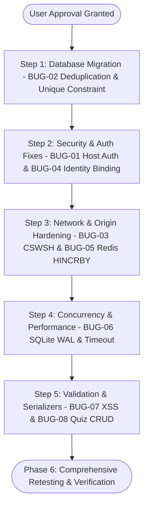

# QUIZ MASTER — PHASE 4 DEBUGGING ACTION PLAN

**Audit Date:** November 17, 2026  
**Status:** **PENDING EXPLICIT USER APPROVAL** (No codebase modifications applied)  
**Auditor:** Senior Software Architect & Engineering Lead  
**Scope:** Remediation plan for bugs identified during Phase 1–3 technical audit.  

---

## 1. Plan Overview & Safety Principles

This document provides the exact technical blueprint for resolving confirmed defects in the Quiz Master platform. 

### Core Guidelines:
- **Zero Premature Modifications:** No source files are modified during Phase 4.
- **Strict API & Event Contract Preservation:** REST responses and WebSocket payloads will maintain full backward compatibility with the React frontend.
- **Zero Data Loss:** Database schema fixes will include safe data migration scripts to deduplicate historical records prior to applying unique constraints.
- **Rollback Readiness:** Every code modification includes an immediate revert strategy.

---

## 2. P0 — CRITICAL DEFECTS

### BUG-01: Unauthenticated WebSocket Host Role Hijacking
- **Priority:** **P0** | **Severity:** Critical
- **1. Root Cause:**
  In [`backend/quiz/consumers.py:289-305`](file:///C:/A2757/QuizProject/backend/quiz/consumers.py#L289-L305), `QuizConsumer._handle_join` extracts `role = data.get("role", "participant")` and sets `is_host = role == "host"` without verifying any authentication token or host ownership against `QuizSession.host`.
- **2. Exact Files Involved:**
  - [`backend/quiz/consumers.py`](file:///C:/A2757/QuizProject/backend/quiz/consumers.py)
  - [`frontend/src/pages/HostActiveQuiz.js`](file:///C:/A2757/QuizProject/frontend/src/pages/HostActiveQuiz.js)
- **3. Proposed Code Change:**
  - **Backend (`consumers.py`):**
    ```python
    # In _handle_join:
    role = data.get("role", "participant")
    is_host = False
    if role == "host":
        token = data.get("token") or self._extract_token_from_headers()
        is_host = await self._verify_host_token(token, self.session_code)
        if not is_host:
            await self.send_json({
                "type": "error",
                "message": "Host authorization failed: valid authentication token required."
            })
            return
    ```
    Implement `@database_sync_to_async def _verify_host_token(token_key, session_code)` to verify that `Token.objects.filter(key=token_key).select_related('user')` matches `QuizSession.objects.get(code=session_code).host`.
  - **Frontend (`HostActiveQuiz.js`):**
    Ensure the host client passes `token: localStorage.getItem('token')` in its `action: "join"` message payload.
- **4. Dependencies:** Django REST Framework `authtoken` model (`Token`).
- **5. Possible Side Effects:**
  If a host opens the quiz without being logged in or if their local storage token is expired, the WebSocket will reject host privileges and prompt re-login.
- **6. Safe Implementation Plan:**
  1. Add token verification logic in `consumers.py` with fallback logging.
  2. Verify that `HostActiveQuiz.js` includes the existing auth token in its join packet.
  3. Execute regression test `SEC-04` using valid and invalid tokens.

---

### BUG-02: Duplicate `AnswerRecord` Database Entries on Concurrency Race
- **Priority:** **P0** | **Severity:** Critical
- **1. Root Cause:**
  [`backend/quiz/models.py:106-112`](file:///C:/A2757/QuizProject/backend/quiz/models.py#L106-L112) lacks a `unique_together` constraint or `UniqueConstraint` on `('participant', 'question')`. In [`backend/quiz/consumers.py:1435-1448`](file:///C:/A2757/QuizProject/backend/quiz/consumers.py#L1435-L1448), concurrent answer arrivals trigger a race condition where `get_or_create` creates multiple rows before committing.
- **2. Exact Files Involved:**
  - [`backend/quiz/models.py`](file:///C:/A2757/QuizProject/backend/quiz/models.py)
  - `backend/quiz/migrations/` (New Migration)
- **3. Proposed Code Change:**
  - In `quiz/models.py`:
    ```python
    class AnswerRecord(models.Model):
        ...
        class Meta:
            unique_together = ('participant', 'question')
            indexes = [
                models.Index(fields=['participant', 'question']),
            ]
    ```
  - Create a two-step migration:
    1. **Data Migration (`000X_cleanup_duplicate_answers.py`):** Deduplicates existing historical duplicate records in `quiz_answerrecord` by retaining only the first created record for each `(participant_id, question_id)` pair.
    2. **Schema Migration:** Applies `unique_together` constraint to the table.
- **4. Dependencies:** Django ORM migration framework.
- **5. Possible Side Effects:**
  Direct database inserts violating the unique constraint will raise `IntegrityError`, which must be caught gracefully in `consumers.py`.
- **6. Safe Implementation Plan:**
  1. Write and test the deduplication script against a backup of `db.sqlite3`.
  2. Apply data migration, then schema migration.
  3. Add `try / except IntegrityError:` around answer creation in `consumers.py`.
  4. Run regression tests `DB-01` and `DB-02`.

---

## 3. P1 — HIGH SEVERITY DEFECTS

### BUG-03: Cross-Site WebSocket Hijacking (CSWSH) via Wildcard Origin
- **Priority:** **P1** | **Severity:** High
- **1. Root Cause:**
  [`backend/backend/settings.py:53-56`](file:///C:/A2757/QuizProject/backend/backend/settings.py#L53-L56) includes `'*'` in `ALLOWED_HOSTS`, causing Channels' `AllowedHostsOriginValidator` to accept WebSocket handshakes from any external website.
- **2. Exact Files Involved:**
  - [`backend/backend/settings.py`](file:///C:/A2757/QuizProject/backend/backend/settings.py)
- **3. Proposed Code Change:**
  In `settings.py`:
  ```python
  ALLOWED_HOSTS = env_list(
      'DJANGO_ALLOWED_HOSTS',
      'localhost,127.0.0.1,0.0.0.0'
  )
  ```
  Explicitly configure trusted origins for development and production without wildcard fallback.
- **4. Dependencies:** None.
- **5. Possible Side Effects:**
  Connections from origins not listed in `ALLOWED_HOSTS` or `CORS_ALLOWED_ORIGINS` will be rejected with HTTP 403.
- **6. Safe Implementation Plan:**
  1. Remove `'*'` from default string.
  2. Verify that `localhost:3000` and `127.0.0.1:3000` connect without error.
  3. Execute regression test `WS-02`.

---

### BUG-04: Player Impersonation in WebSocket Answer Submissions
- **Priority:** **P1** | **Severity:** High
- **1. Root Cause:**
  [`backend/quiz/consumers.py:483-490`](file:///C:/A2757/QuizProject/backend/quiz/consumers.py#L483-L490) extracts `username = data.get("username", "")` directly from the client payload instead of using `self.username` established during the authenticated `join` phase.
- **2. Exact Files Involved:**
  - [`backend/quiz/consumers.py`](file:///C:/A2757/QuizProject/backend/quiz/consumers.py)
- **3. Proposed Code Change:**
  ```python
  # In _handle_answer:
  if not self.username:
      await self.send_json({"type": "error", "message": "Participant not registered on this connection."})
      return
  
  # Strictly use socket-bound identity:
  username = self.username
  ```
- **4. Dependencies:** `self.username` properly populated in `_handle_join`.
- **5. Possible Side Effects:**
  None for legitimate players. Attackers attempting to pass arbitrary `username` parameters will have their payloads evaluated against their own socket identity.
- **6. Safe Implementation Plan:**
  1. Replace `data.get("username")` with `self.username`.
  2. Execute regression test `SEC-05`.

---

### BUG-05: Live Vote Count Inflation via Unvalidated Redis `HINCRBY`
- **Priority:** **P1** | **Severity:** High
- **1. Root Cause:**
  [`backend/quiz/consumers.py:516-523`](file:///C:/A2757/QuizProject/backend/quiz/consumers.py#L516-L523) runs `redis.hincrby(vote_key, choice_id, 1)` unconditionally upon receiving an answer packet, before checking if the user already submitted a choice for the current question.
- **2. Exact Files Involved:**
  - [`backend/quiz/consumers.py`](file:///C:/A2757/QuizProject/backend/quiz/consumers.py)
- **3. Proposed Code Change:**
  Use an atomic Redis set `session:{pin}:voted:{qid}` via `SADD`. If `SADD` returns `0` (user already voted), reject duplicate vote tallying:
  ```python
  has_voted = await self.redis_client.sadd(f"session:{self.session_code}:voted:{question_id}", self.username)
  if has_voted == 0:
      await self.send_json({"type": "error", "message": "Answer already submitted for this question."})
      return
  # Only increment tally if this is the user's first submission:
  await self.redis_client.hincrby(f"session:{self.session_code}:votes:{question_id}", str(choice_id), 1)
  ```
- **4. Dependencies:** Redis server connection.
- **5. Possible Side Effects:**
  Prevents rapid multi-clicking from inflating host charts.
- **6. Safe Implementation Plan:**
  1. Add Redis `sadd` check prior to `hincrby`.
  2. Execute regression test `SEC-06`.

---

### BUG-06: Database Lock Contention Under Concurrency (>50 users)
- **Priority:** **P1** | **Severity:** High (Performance / Scalability)
- **1. Root Cause:**
  SQLite default settings use `journal_mode=DELETE` and a low connection busy timeout (5.0s), which locks the entire database file during writes and causes HTTP 500 errors during concurrent participant registration.
- **2. Exact Files Involved:**
  - [`backend/backend/settings.py`](file:///C:/A2757/QuizProject/backend/backend/settings.py)
- **3. Proposed Code Change:**
  In `settings.py`:
  ```python
  DATABASES = {
      'default': {
          'ENGINE': 'django.db.backends.sqlite3',
          'NAME': BASE_DIR / 'db.sqlite3',
          'OPTIONS': {
              'timeout': 30.0,  # Increase busy timeout from 5.0 to 30.0 seconds
          }
      }
  }
  ```
  And configure SQLite Write-Ahead Logging (WAL) mode via a startup hook or database connection signal:
  ```python
  from django.db.backends.signals import connection_created
  def set_sqlite_wal(sender, connection, **kwargs):
      if connection.vendor == 'sqlite':
          cursor = connection.cursor()
          cursor.execute('PRAGMA journal_mode=WAL;')
          cursor.execute('PRAGMA synchronous=NORMAL;')
  connection_created.connect(set_sqlite_wal)
  ```
- **4. Dependencies:** SQLite 3 engine.
- **5. Possible Side Effects:**
  Creates temporary `-wal` and `-shm` companion files alongside `db.sqlite3`. Substantially reduces write lock contention.
- **6. Safe Implementation Plan:**
  1. Update `DATABASES['default']['OPTIONS']['timeout'] = 30.0`.
  2. Connect WAL initialization signal in `backend/quiz/apps.py`.
  3. Re-run 100-user load test to verify error rate reduction.

---

## 4. P2 — MEDIUM SEVERITY DEFECTS

### BUG-07: Unsanitized Player Username (Stored XSS Risk)
- **Priority:** **P2** | **Severity:** Medium
- **1. Root Cause:**
  [`backend/quiz/views.py:328-354`](file:///C:/A2757/QuizProject/backend/quiz/views.py#L328-L354) accepts unvalidated characters in the `username` field, persisting raw `<script>` tags to the database.
- **2. Exact Files Involved:**
  - [`backend/quiz/views.py`](file:///C:/A2757/QuizProject/backend/quiz/views.py)
  - [`backend/quiz/serializers.py`](file:///C:/A2757/QuizProject/backend/quiz/serializers.py)
- **3. Proposed Code Change:**
  Enforce alphanumeric regex validation and HTML entity escaping:
  ```python
  import re
  import html

  raw_username = data.get("username", "").strip()
  if not re.match(r'^[a-zA-Z0-9_\-\s]{2,25}$', raw_username):
      return Response({"error": "Username must be 2-25 alphanumeric characters."}, status=status.HTTP_400_BAD_REQUEST)
  sanitized_username = html.escape(raw_username)
  ```
- **4. Dependencies:** Python standard libraries (`re`, `html`).
- **5. Possible Side Effects:**
  Rejects usernames with exotic symbols or script tags at registration time.
- **6. Safe Implementation Plan:**
  1. Add validator to `JoinSessionView`.
  2. Execute regression test `SEC-08`.

---

### BUG-08: Quiz Set Creation Fails on Empty Questions Array
- **Priority:** **P2** | **Severity:** Medium
- **1. Root Cause:**
  [`backend/quiz/serializers.py:12-25`](file:///C:/A2757/QuizProject/backend/quiz/serializers.py#L12-L25) marks `questions` as a required nested serializer field, preventing administrators from saving a new quiz draft before adding questions.
- **2. Exact Files Involved:**
  - [`backend/quiz/serializers.py`](file:///C:/A2757/QuizProject/backend/quiz/serializers.py)
- **3. Proposed Code Change:**
  Mark `questions = QuestionSerializer(many=True, required=False, read_only=True)` or add `required=False` with safe handling in `create()` method.
- **4. Dependencies:** DRF Serializer.
- **5. Possible Side Effects:**
  Allows quiz drafts with zero questions to be saved.
- **6. Safe Implementation Plan:**
  1. Update serializer definition.
  2. Execute regression test `QUIZ-01`.

---

### BUG-09: In-Memory `runtime_sessions` Dict Breaks Multi-Worker Scale
- **Priority:** **P2** | **Severity:** Medium
- **1. Root Cause:**
  [`backend/quiz/consumers.py:52-92`](file:///C:/A2757/QuizProject/backend/quiz/consumers.py#L52-L92) caches live session state in a Python dictionary `runtime_sessions = {}` in addition to Redis.
- **2. Exact Files Involved:**
  - [`backend/quiz/consumers.py`](file:///C:/A2757/QuizProject/backend/quiz/consumers.py)
- **3. Proposed Code Change:**
  Refactor helper methods (`_get_runtime_session`, `_update_runtime_session`) to read/write state exclusively through Redis hashes and JSON strings, removing the local in-process dictionary.
- **4. Dependencies:** Redis Channel Layer.
- **5. Possible Side Effects:**
  Slightly higher Redis query volume; perfect cross-worker synchronization.
- **6. Safe Implementation Plan:**
  1. Centralize session state retrieval into Redis helper methods.
  2. Test multi-process Daphne workers locally.

---

## 5. P3 — LOW SEVERITY DEFECTS

### BUG-10: Duplicate Style Keys and ESLint Warnings in Frontend
- **Priority:** **P3** | **Severity:** Low
- **1. Root Cause:**
  [`frontend/src/pages/Lobby.js`](file:///C:/A2757/QuizProject/frontend/src/pages/Lobby.js) and `AudienceDisplay.js` contain duplicated inline style properties (e.g. redundant `background` rules) causing React compiler warnings.
- **2. Exact Files Involved:**
  - [`frontend/src/pages/Lobby.js`](file:///C:/A2757/QuizProject/frontend/src/pages/Lobby.js)
  - [`frontend/src/pages/AudienceDisplay.js`](file:///C:/A2757/QuizProject/frontend/src/pages/AudienceDisplay.js)
- **3. Proposed Code Change:**
  Clean duplicated CSS properties and resolve unused variable warnings.
- **4. Dependencies:** None.
- **5. Possible Side Effects:** Clean browser console output.

---

## 6. Execution Order & Phasing



---

## 7. Next Action

**I am currently STOPPED as required by Phase 4 instructions.**  
No files have been modified. Please review this debugging action plan and provide your explicit approval to proceed with Phase 5 implementation.
