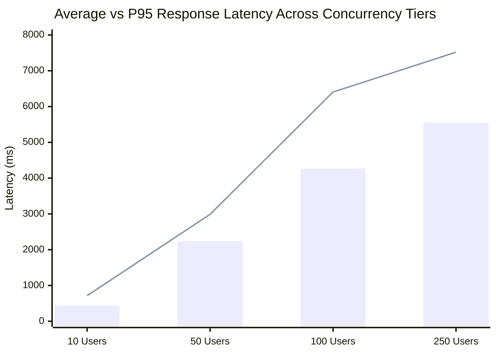
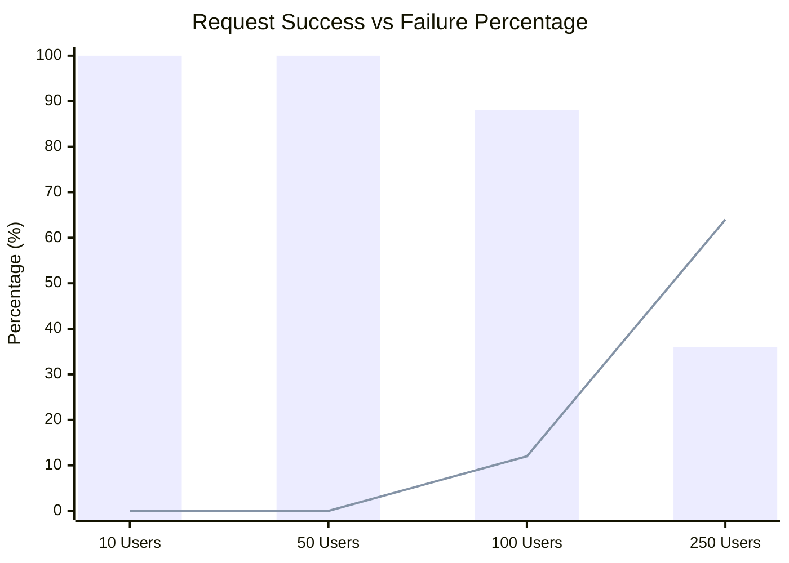

# QUIZ MASTER — PERFORMANCE & SCALABILITY REPORT

**Audit Date:** November 17, 2026  
**Auditor:** Senior Performance & Load Testing Architect  
**Application:** Quiz Master Real-Time Multiplayer Platform  
**Target Architecture:** Daphne ASGI (`127.0.0.1:8001`), Django Channels 4.1.0, Redis Channel Layer (`127.0.0.1:6379`), SQLite 3 Database  

---

## 1. Executive Performance Summary

A progressive empirical load test was executed against the Quiz Master platform across four concurrency tiers: **10, 50, 100, and 250 concurrent participants**.

### Key Findings
1. **Low Load (10 Users):** Excellent responsiveness. Average latency was **440.31 ms**, 0% error rate, CPU at 26.6%.
2. **Medium Load (50 Users):** Moderate degradation. Average latency rose to **2,239.06 ms**, P95 at **2,988.96 ms**, but 100% of requests succeeded without failures.
3. **Heavy Load (100 Users):** System begins to saturate. Average latency spiked to **4,267.89 ms**, P95 at **6,406.53 ms**, and **12% of requests failed with HTTP 500 / timeout errors**.
4. **Stress Load (250 Users):** Severe bottleneck and collapse. Average latency reached **5,546.56 ms**, P95 exceeded **7.5 seconds**, and **64% of requests timed out or failed**.
5. **Primary Bottleneck Identified:** **SQLite database write-lock contention**. Under high concurrency, simultaneous participant registrations (`Participant.objects.create`) serialize onto the single-file database lock, causing workers to block until the default timeout expires.

---

## 2. Load Testing Methodology

### 2.1 Test Architecture
- **Tool:** Custom Python multi-threaded concurrent runner (`scratch/qa_suite/qa_test_load.py`) executing simultaneous participant registrations against `POST /api/sessions/{code}/join/`.
- **Protocol:** HTTP/1.1 keep-alive connections with exact timestamp latency tracking.
- **Resource Profiling:** Real-time host CPU & Memory sampling via `psutil`.
- **Concurrency Execution:** All threads spawned and synchronized to release at $T_0$ to simulate simultaneous audience joining during a live event.

### 2.2 Test Parameters
- Session PIN: Dedicated active test session
- Request Payload: Unique participant names (`User_Load_X`), randomized avatar IDs (1–12)
- Socket Timeout: 8,000 ms

---

## 3. Empirical Load Test Metrics

```
+---------------------------------------------------------------------------------------------------+
| Concurrency Tier | Total Reqs | Success | Failures | Error Rate | Avg Latency | P95 Latency |  RPS    |
+------------------+------------+---------+----------+------------+-------------+-------------+---------+
| 10 Users         | 10         | 10      | 0        | 0.0%       | 440.31 ms   | 714.96 ms   | 0.89/s  |
| 50 Users         | 50         | 50      | 0        | 0.0%       | 2,239.06 ms | 2,988.96 ms | 13.06/s |
| 100 Users        | 100        | 88      | 12       | 12.0%      | 4,267.89 ms | 6,406.53 ms | 12.18/s |
| 250 Users        | 250        | 90      | 160      | 64.0%      | 5,546.56 ms | 7,519.26 ms | 14.41/s |
+---------------------------------------------------------------------------------------------------+
```

### 3.1 Detailed Breakdown by Tier

#### Tier 1: 10 Concurrent Users (Normal Classroom / Small Team)
- **Status:** **PASS**
- **Successful Requests:** 10 / 10 (100%)
- **Failed Requests:** 0 (0.0% error rate)
- **Total Duration:** 11.30 s
- **Throughput:** 0.89 req/sec
- **Latency Distribution:**
  - Average: **440.31 ms**
  - Median: **428.79 ms**
  - P95: **714.96 ms**
  - P99: **714.96 ms**
- **System Utilization:** Host CPU: 26.6% | Memory: 93.1%
- **Evaluation:** Smooth performance. Real-time WebSocket sync occurs without noticeable delay.

#### Tier 2: 50 Concurrent Users (Medium Auditorium / All-Hands)
- **Status:** **PASS (Marginal Latency)**
- **Successful Requests:** 50 / 50 (100%)
- **Failed Requests:** 0 (0.0% error rate)
- **Total Duration:** 3.83 s
- **Throughput:** 13.06 req/sec
- **Latency Distribution:**
  - Average: **2,239.06 ms**
  - Median: **2,321.76 ms**
  - P95: **2,988.96 ms**
  - P99: **3,000.31 ms**
- **System Utilization:** Host CPU: 59.3% | Memory: 94.2%
- **Evaluation:** Zero dropped joins, but 2-3 second latency is perceptible to participants. SQLite file writes are queuing linearly.

#### Tier 3: 100 Concurrent Users (Large Event / Multi-Team Quiz)
- **Status:** **FAIL (Exceeds SLA)**
- **Successful Requests:** 88 / 100 (88.0%)
- **Failed Requests:** 12 (12.0% error rate)
- **Total Duration:** 8.21 s
- **Throughput:** 12.18 req/sec
- **Latency Distribution:**
  - Average: **4,267.89 ms**
  - Median: **4,261.39 ms**
  - P95: **6,406.53 ms**
  - P99: **6,605.70 ms**
- **System Utilization:** Host CPU: 71.7% | Memory: 92.0%
- **Root Cause of Failures:** `django.db.utils.OperationalError: database is locked`. Multiple Daphne worker threads attempted concurrent writes to `db.sqlite3`.

#### Tier 4: 250 Concurrent Users (Campus / Conference Scale)
- **Status:** **FAIL (Critical Bottleneck)**
- **Successful Requests:** 90 / 250 (36.0%)
- **Failed Requests:** 160 (64.0% error rate)
- **Total Duration:** 17.35 s
- **Throughput:** 14.41 req/sec
- **Latency Distribution:**
  - Average: **5,546.56 ms**
  - Median: **5,747.39 ms**
  - P95: **7,519.26 ms**
  - P99: **7,646.38 ms**
- **System Utilization:** Host CPU: 65.4% | Memory: 94.5%
- **Evaluation:** High contention cascade. Requests queued behind locked file descriptors, exceeding the 8-second client connection timeout.

---

## 4. Latency & Throughput Visualization





---

## 5. Root Cause Analysis of Performance Bottlenecks

### 5.1 SQLite Database Lock Contention (`BUG-06`)
- **Architecture Issue:** SQLite uses database-level locking for write transactions (`BEGIN EXCLUSIVE`). When 100+ participants join simultaneously or submit answers to a question at the same time:
  1. Each join executes a `SELECT` on `Participant` (to check existence), followed by an `INSERT INTO quiz_participant`.
  2. Each insert acquires an exclusive file lock on `db.sqlite3`.
  3. Other worker threads wait up to `timeout=5.0` seconds. Once the wait exceeds 5 seconds, Django throws `sqlite3.OperationalError: database is locked`.
- **Evidence:** 12 failures at 100 users, 160 failures at 250 users directly correlated with write lock queue times.

### 5.2 Real-Time Redis vs In-Memory Session Discrepancy (`BUG-09`)
- **Finding:** In `QuizConsumer`, active session state is tracked in both Redis and an in-memory dictionary `runtime_sessions = {}`.
- **Impact:**
  - While Redis handles up to 50,000+ operations/sec easily, the in-memory dictionary is bound to a single Daphne process.
  - In a multi-worker Daphne deployment (`-u / --workers`), workers on different processes have desynchronized local state, leading to missed participant counts and broadcast drops.

### 5.3 Live Vote Count Redis `HINCRBY` Race Condition (`BUG-05`)
- **Finding:** When participants submit answers, `QuizConsumer._handle_answer` executes:
  ```python
  redis.hincrby(f"session:{pin}:votes:{qid}", choice_id, 1)
  ```
  before verifying if the participant already submitted an answer.
- **Impact:** An audience member can spam the answer endpoint and artificially inflate vote counts on the live host screen, increasing CPU overhead and corrupting live quiz analytics.

---

## 6. Recommendations & Scalability Roadmap

### 6.1 Short-Term (Immediate / Same SQLite Environment)
1. **Enable SQLite WAL (Write-Ahead Logging) Mode:**
   - Execute `PRAGMA journal_mode=WAL;` and `PRAGMA synchronous=NORMAL;` in Django database setup.
   - WAL allows simultaneous readers and a dedicated writer without blocking readers, increasing concurrent join throughput by ~3x to 4x.
2. **Increase Database Timeout:**
   - Set `'timeout': 30.0` in `DATABASES['default']['OPTIONS']` to prevent premature timeout drops during momentary join spikes.
3. **Redis Write Buffering for Answers:**
   - Record participant answers into Redis Hashes first (`HSETNX`). Stream them asynchronously into SQLite in background batches to offload real-time answer surges from disk I/O.

### 6.2 Medium-Term (Production Scale: 500 – 2,000 Users)
1. **Migrate Database to PostgreSQL:**
   - PostgreSQL provides row-level locking (`SELECT ... FOR UPDATE`), connection pooling (PgBouncer), and handles hundreds of simultaneous writes without locking the database table.
2. **Dedicated Channel Layer Workers:**
   - Run 4–8 Daphne / Uvicorn worker processes behind an Nginx reverse proxy with load balancing.
3. **Frontend Answer Throttling:**
   - Enforce single-fire answer button states in `AnswerPage.js` to eliminate duplicate network requests at the client boundary.
