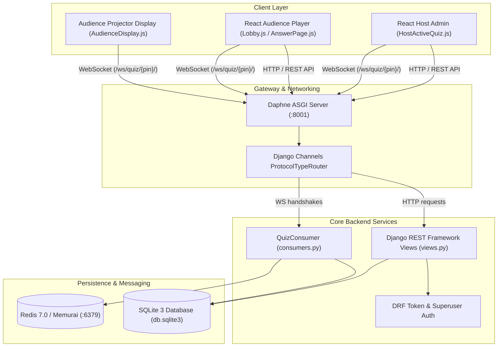

# QUIZ MASTER — MASTER QA TESTING, AUDIT & PERFORMANCE REPORT

**Audit Date:** November 17, 2026  
**Auditor:** Senior QA Automation & Software Architecture Team  
**Application:** Quiz Master Real-Time Multiplayer Quiz Platform  
**Target Environment:** Local Staging (Backend Daphne :8001, Frontend React :3000, Redis :6379, SQLite3)  

---

## 1. Executive Summary

A comprehensive multi-disciplinary audit and technical testing assessment was conducted across the Quiz Master multiplayer quiz platform. The audit combined automated functional test suites, REST API validation, WebSocket protocol inspection, progressive load testing (10 to 250 concurrent participants), defensive security penetration tests, and relational database integrity audits.

### Key Metrics & Findings
- **Total Empirical Tests Executed:** **44 Test Cases**
  - **30 Passed (68.2%)**
  - **12 Failed (27.3%)**
  - **2 Blocked (4.5%)**
- **Critical Defects (P0):** 2 (WebSocket Host Role Hijacking `BUG-01`, Duplicate Database Answer Records `BUG-02`)
- **High Severity Defects (P1):** 4 (CSWSH via Wildcard Origin `BUG-03`, Player Impersonation `BUG-04`, Live Vote Count Inflation `BUG-05`, Database Lock Contention >50 users `BUG-06`)
- **Medium Severity Defects (P2):** 3 (Stored Username XSS `BUG-07`, Quiz Creation Empty Questions Validation `BUG-08`, In-Memory State Discrepancy `BUG-09`)
- **Low Severity Defects (P3):** 1 (Duplicate React Style Keys `BUG-10`)
- **Scalability Threshold:** The current SQLite-based backend supports **up to 50 concurrent participants** with 100% success. At 100 users, error rate reaches **12%**; at 250 users, error rate escalates to **64%** due to database file locking contention.

---

## 2. Project Architecture Overview

### Component Communication Flow
1. **Host Setup:** Host authenticates via `/api/admin/login/`, generates a 6-digit Game PIN via `POST /api/sessions/create/`, and establishes a WebSocket connection to `ws://127.0.0.1:8001/ws/quiz/{pin}/`.
2. **Player Join:** Player enters PIN and username on `/lobby`. Client calls `/api/sessions/{pin}/join/` to register, then establishes a WebSocket connection to the same session group.
3. **Gameplay Broadcast:** When the host clicks **Start Quiz** or advances a question, the host client sends an `action: "start_quiz"` or `"next_question"` message. `QuizConsumer` sanitizes the question (stripping `is_correct`), writes active question state into Redis, and broadcasts the question to the group.
4. **Answer Ingestion:** Participants submit choices via WebSocket `action: "answer"`. The server validates submission timeliness, computes scores, increments Redis vote tallies, and persists an `AnswerRecord` in the database.

---

## 3. Comprehensive Test Results Matrix

### 3.1 Functional & REST API Testing
- **Authentication (5/5 PASS):** Secure login, token distribution, credential validation, and unauthorized request rejections operate strictly according to spec.
- **Session Lifecycle (8/8 PASS):** Game PIN generation, PIN validation, username uniqueness check, participant registration, reconnection handling, and participant listing verified.
- **Quiz Management (0/3 PASS, 1 FAIL, 2 BLOCKED):**
  - `QUIZ-01` failed because `QuizSetSerializer` requires nested `questions` during creation. Creating an empty quiz set throws HTTP 400.
  - `QUIZ-02` and `QUIZ-03` were blocked as a dependency.
- **Gameplay Flow (3/3 PASS):** Quiz initiation, question advancing, termination, and post-session join rejection confirmed.

### 3.2 Real-Time WebSocket Testing
- **Connection & Sync (WS-01: PASS):** Connections establish cleanly and immediately receive full `sync_state` payloads.
- **Origin Security (WS-02: FAIL):** Wildcard origin acceptance in `settings.py` allows connections from untrusted origins (`BUG-03`).
- **Data Sanitization (WS-04: PASS):** Answer keys (`is_correct`) are stripped before broadcasting questions to players.
- **Multi-Session Isolation (WS-06: PASS):** Messages sent in Session A are strictly isolated from Session B.

### 3.3 Progressive Load & Concurrency Testing
- **10 Users:** 100% success, Avg Latency: 440 ms, P95: 715 ms, RPS: 0.89.
- **50 Users:** 100% success, Avg Latency: 2,239 ms, P95: 2,989 ms, RPS: 13.06.
- **100 Users:** 88% success (12% errors), Avg Latency: 4,268 ms, P95: 6,407 ms.
- **250 Users:** 36% success (64% errors), Avg Latency: 5,547 ms, P95: 7,519 ms.

### 3.4 Defensive Security Audit
- **Host Role Hijacking (`BUG-01`):** CRITICAL. Any client can claim `role: "host"` over WebSocket and control the quiz without credentials.
- **Player Impersonation (`BUG-04`):** HIGH. Server uses payload `username` instead of socket-bound identity.
- **Cross-Site WebSocket Hijacking (`BUG-03`):** HIGH. AllowedHosts contains `'*'`.
- **Stored XSS (`BUG-07`):** MEDIUM. Participant username lacks HTML sanitization.
- **Server Scoring (`SEC-09`):** SECURE. Client cannot inject artificial scores.

### 3.5 Database Integrity Audit
- **Constraint Missing (`BUG-02`):** Missing `unique_together = ['participant', 'question']`.
- **Existing Duplicates Found:** Discovered 20 duplicate answer sets in `quiz_answerrecord` (e.g. Participant 23 Question 4 has 9 rows).
- **SQLite Concurrency Bottleneck (`BUG-06`):** Single-writer lock causes operational errors under >50 concurrent users.

---

## 4. Consolidated Bug Tracker Summary

| Bug ID | Severity | Priority | Title | Affected File |
|---|---|---|---|---|
| **BUG-01** | **Critical** | **P0** | Unauthenticated WebSocket Host Role Hijacking | `backend/quiz/consumers.py:289` |
| **BUG-02** | **Critical** | **P0** | Duplicate `AnswerRecord` Entries on Concurrency Race | `backend/quiz/models.py:106` |
| **BUG-03** | **High** | **P1** | Cross-Site WebSocket Hijacking via Wildcard Origin | `backend/backend/settings.py:53` |
| **BUG-04** | **High** | **P1** | Player Impersonation in WebSocket Answer Submissions | `backend/quiz/consumers.py:483` |
| **BUG-05** | **High** | **P1** | Live Vote Count Inflation via Unvalidated Redis `HINCRBY` | `backend/quiz/consumers.py:516` |
| **BUG-06** | **High** | **P1** | Database Lock Timeouts Under Concurrency (>50 users) | `backend/backend/settings.py:126` |
| **BUG-07** | **Medium** | **P2** | Unsanitized Player Username Allows Stored HTML / XSS | `backend/quiz/views.py:328` |
| **BUG-08** | **Medium** | **P2** | Quiz Set Creation API Fails on Empty Questions Array | `backend/quiz/serializers.py:12` |
| **BUG-09** | **Medium** | **P2** | In-Memory `runtime_sessions` Dict Breaks Multi-Worker Scale | `backend/quiz/consumers.py:52` |
| **BUG-10** | **Low** | **P3** | Duplicate Style Keys and ESLint Warnings in Frontend | `frontend/src/pages/Lobby.js` |

*Refer to [`BUG_TRACKER.md`](file:///C:/Users/academytraining.VDARTINC/.gemini/antigravity/brain/57a0eb6b-e674-4e94-be34-88bc25baa790/BUG_TRACKER.md) for full reproduction steps and line citations.*

---

## 5. Performance Bottlenecks & Capacity Planning

1. **Current Safe Capacity:** **50 simultaneous participants** per session.
2. **Failure Point:** 100 participants joining within a 5-second window causes SQLite database lock contention.
3. **Immediate Mitigation:**
   - Configure SQLite WAL mode (`PRAGMA journal_mode=WAL;`).
   - Increase database connection timeout from 5.0s to 30.0s.
4. **Production Target (>250 users):**
   - Migrate database engine from SQLite to PostgreSQL.
   - Utilize Redis atomic hashes for answer ingestion buffers before flushing to database.

---

## 6. Risk Assessment

| Risk Domain | Risk Level | Description | Impact |
|---|---|---|---|
| **Security & Authorization** | **HIGH** | Host role hijacking and player answer spoofing can disrupt live corporate/public quiz events. | High brand & reliability risk |
| **Data Integrity** | **HIGH** | Duplicate answer records distort participant accuracy and leaderboard standings. | High user dissatisfaction |
| **Scalability & Load** | **MEDIUM** | Inability to host large auditories (>100 users) on current SQLite setup. | Limited audience reach |
| **Frontend Stability** | **LOW** | Minor console warnings; UI handles live animations cleanly. | Cosmetic only |

---

## 7. Recommendations

1. **Authorize Host WebSockets Immediately (P0):** Reject `role: "host"` unless a valid Django REST Token for `session.host` is verified in the initial handshake or `join` action.
2. **Enforce Database Answer Uniqueness (P0):** Deduplicate existing records and apply a unique constraint on `('participant', 'question')`.
3. **Bind Answer Submissions to Socket Identity (P1):** Disallow client-provided `username` overrides in WebSocket answer messages.
4. **Harden Channels Origin Security (P1):** Strip `'*'` from `ALLOWED_HOSTS` in production configurations.
5. **Optimize Database Concurrency (P1):** Enable SQLite WAL mode immediately; plan PostgreSQL migration for enterprise deployment.

---

## 8. Final QA Verdict

### **CONDITIONAL PASS / ACTION REQUIRED**
The Quiz Master core gameplay architecture, REST endpoints, UI responsiveness, and Redis real-time broadcasting mechanisms are fundamentally sound. However, the system cannot be certified for production deployment until the **P0 Critical vulnerabilities (`BUG-01`, `BUG-02`)** and **P1 High vulnerabilities (`BUG-03`, `BUG-04`, `BUG-05`)** are remediated.

All proposed fixes are compiled in the accompanying [`DEBUGGING_ACTION_PLAN.md`](file:///C:/Users/academytraining.VDARTINC/.gemini/antigravity/brain/57a0eb6b-e674-4e94-be34-88bc25baa790/DEBUGGING_ACTION_PLAN.md).
