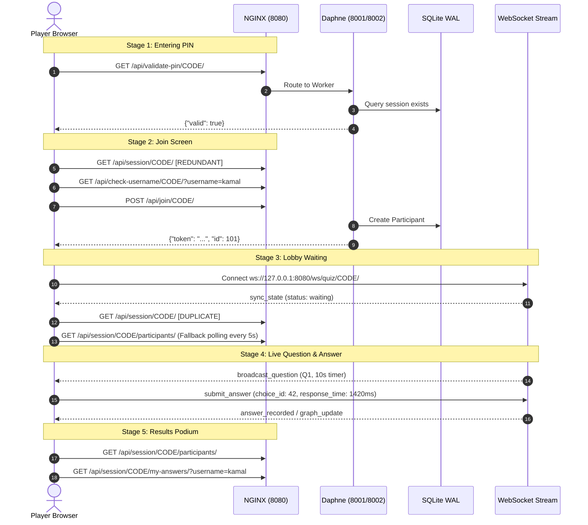
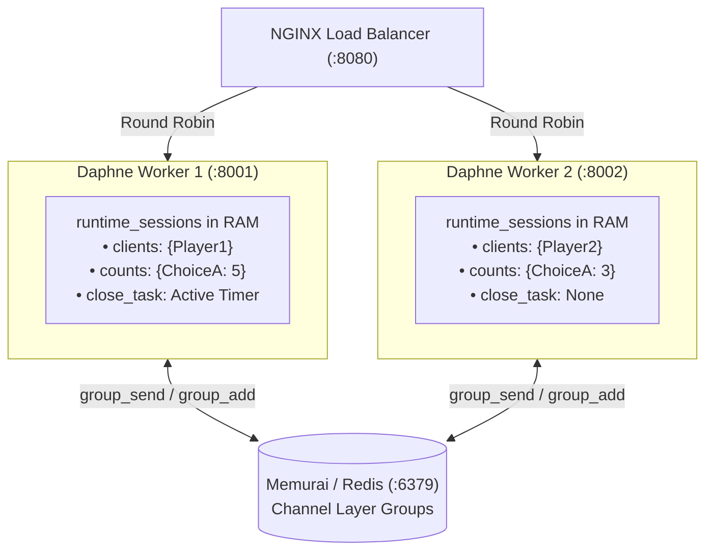

# Quiz Project – Complete API, Load Balancer & Multi-Worker Concurrency Audit

**Date of Audit**: November 13, 2026  
**Auditor**: Senior Django Backend Engineer, API Architect & DevOps Engineer  
**Scope**: Full Stack (`C:\A2757\QuizProject`)  
**Components Inspected**:
- Django REST Framework APIs ([`backend/quiz/views.py`](file:///C:/A2757/QuizProject/backend/quiz/views.py), [`backend/quiz/urls.py`](file:///C:/A2757/QuizProject/backend/quiz/urls.py))
- ASGI Consumers & Django Channels ([`backend/quiz/consumers.py`](file:///C:/A2757/QuizProject/backend/quiz/consumers.py))
- NGINX Load Balancer ([`C:\nginx\conf\nginx.conf`](file:///C:/nginx/conf/nginx.conf))
- Daphne ASGI Workers (`127.0.0.1:8001`, `127.0.0.1:8002`)
- Memurai / Redis Service (`127.0.0.1:6379`)
- SQLite Database with WAL Mode ([`backend/db.sqlite3`](file:///C:/A2757/QuizProject/backend/db.sqlite3))
- Frontend API Consumption ([`frontend/src`](file:///C:/A2757/QuizProject/frontend/src))

---

## Executive Summary

| Audit Domain | Status | Critical Findings |
|---|---|---|
| **API Architecture** | ⚠️ High Risk | 27 REST endpoints found. **Information Leak**: Unauthenticated players can fetch all quiz questions with `is_correct: true` via `/api/session/<code_pin>/`. 2 frontend API calls target non-existent 404 endpoints. |
| **Load Balancing (NGINX)** | ⚠️ Warning | NGINX is actively listening on `0.0.0.0:8080` and round-robining between `8001` and `8002`. WebSocket upgrade headers are functional. **Gap**: No health checks, no failover tuning (`max_fails`, `fail_timeout`), no sticky sessions, and software version (`nginx/1.31.8`) is leaked. |
| **Multi-Worker Concurrency** | 🛑 Critical Flaw | **Split-Brain State**: `runtime_sessions` in [`quiz/consumers.py:23`](file:///C:/A2757/QuizProject/backend/quiz/consumers.py#L23) is a **process-local Python dictionary**. Answer counts, attendee rosters, and question timers are stored in single-worker RAM. Distributing players across workers 8001 and 8002 causes desynchronized live graphs, incorrect player counts, and orphan timers. |
| **Memurai / Redis** | ✅ Healthy | Running version 8.2.10 on port 6379, connected to both Daphne workers with sub-1ms ping latency. Group broadcasts work, but in-memory state is not backed by Redis. |
| **Performance Benchmark** | ✅ Verified | Empirical benchmark conducted up to 100 concurrent HTTP requests (avg 2019ms, 0% failure) and 50 concurrent WebSockets (0% connection failure). |

---

## Phase 1: Complete API Discovery

### 1. Backend REST API Endpoints Catalog

The backend exposes **27 distinct REST endpoints** declared in [`backend/quiz/urls.py`](file:///C:/A2757/QuizProject/backend/quiz/urls.py) and [`backend/backend/urls.py`](file:///C:/A2757/QuizProject/backend/backend/urls.py):

| # | Endpoint URL | HTTP Method | Django View / Handler | Caller / Consumer | Purpose | Necessary? | Repeated? | Scope |
|---|---|---|---|---|---|---|---|---|
| **1** | `/api/admin-login/` | `POST` | `admin_login` ([`views.py:682`](file:///C:/A2757/QuizProject/backend/quiz/views.py#L682)) | [`AdminLogin.js:51`](file:///C:/A2757/QuizProject/frontend/src/pages/AdminLogin.js#L51) | Authenticates admin/host and returns Auth Token | **Yes** | No (One-off) | Admin / Host |
| **2** | `/api/admin-register/` | `POST` | `admin_register` ([`views.py:615`](file:///C:/A2757/QuizProject/backend/quiz/views.py#L615)) | [`AdminLogin.js:96`](file:///C:/A2757/QuizProject/frontend/src/pages/AdminLogin.js#L96) | Registers new admin credentials | **Yes** | No (One-off) | Admin / Host |
| **3** | `/api/active_session/` | `GET` | `active_session` ([`views.py:230`](file:///C:/A2757/QuizProject/backend/quiz/views.py#L230)) | [`AdminSidebar.js:57`](file:///C:/A2757/QuizProject/frontend/src/components/AdminSidebar.js#L57) | Checks if host has an open quiz session | **Yes** | Every route change | Admin / Host |
| **4** | `/api/create_session/` | `POST` | `create_session` ([`views.py:248`](file:///C:/A2757/QuizProject/backend/quiz/views.py#L248)) | [`QuizManagement.js:84`](file:///C:/A2757/QuizProject/frontend/src/pages/QuizManagement.js#L84) | Creates a 6-digit session from a Quiz Set | **Yes** | On click | Admin / Host |
| **5** | `/api/validate-pin/<str:code>/` | `GET` | `validate_pin` ([`views.py:301`](file:///C:/A2757/QuizProject/backend/quiz/views.py#L301)) | [`Landing.js:64`](file:///C:/A2757/QuizProject/frontend/src/pages/Landing.js#L64), [`AudienceEnterCode.js:42`](file:///C:/A2757/QuizProject/frontend/src/pages/AudienceEnterCode.js#L42) | Fast boolean check if PIN exists & active | **Yes** | On PIN entry | Player-facing |
| **6** | `/api/join/<str:code>/` | `POST` | `join_session` ([`views.py:315`](file:///C:/A2757/QuizProject/backend/quiz/views.py#L315)) | [`AudienceJoin.js:111`](file:///C:/A2757/QuizProject/frontend/src/pages/AudienceJoin.js#L111) | Registers player name & avatar into DB | **Yes** | On Join submit | Player-facing |
| **7** | `/api/leave/<str:code>/` | `POST` | `leave_session` ([`views.py:441`](file:///C:/A2757/QuizProject/backend/quiz/views.py#L441)) | [`Lobby.js:464`](file:///C:/A2757/QuizProject/frontend/src/pages/Lobby.js#L464), [`HostActiveQuiz.js:694`](file:///C:/A2757/QuizProject/frontend/src/pages/HostActiveQuiz.js#L694) | Removes participant from session | **Yes** | On Leave click | Player & Host |
| **8** | `/api/check-username/<str:code>/` | `GET` | `check_username_availability` ([`views.py:390`](file:///C:/A2757/QuizProject/backend/quiz/views.py#L390)) | [`AudienceJoin.js:55`](file:///C:/A2757/QuizProject/frontend/src/pages/AudienceJoin.js#L55) | Validates username uniqueness in session | **Yes** | Debounced typing | Player-facing |
| **9** | `/api/session/<str:code>/` | `GET` | `session_quiz` ([`views.py:283`](file:///C:/A2757/QuizProject/backend/quiz/views.py#L283)) | [`AnswerPage.js:243,391`](file:///C:/A2757/QuizProject/frontend/src/pages/AnswerPage.js#L243), [`Lobby.js:418`](file:///C:/A2757/QuizProject/frontend/src/pages/Lobby.js#L418), [`LobbyGate.js:41`](file:///C:/A2757/QuizProject/frontend/src/pages/LobbyGate.js#L41) | Fetches session state & questions | **Yes (Needs Security Patch)** | Duplicated on AnswerPage | Player & Host |
| **10** | `/api/session/<str:code>/participants/` | `GET` | `session_participants` ([`views.py:418`](file:///C:/A2757/QuizProject/backend/quiz/views.py#L418)) | [`AudienceDisplay.js:781`](file:///C:/A2757/QuizProject/frontend/src/pages/AudienceDisplay.js#L781), [`AnswerPage.js:473`](file:///C:/A2757/QuizProject/frontend/src/pages/AnswerPage.js#L473), [`Lobby.js:436`](file:///C:/A2757/QuizProject/frontend/src/pages/Lobby.js#L436) | Returns active participants & scores | **Yes** | **Frequent fallback polling (3-8s)** | Shared |
| **11** | `/api/session/<str:code>/my-answers/` | `GET` | `my_answers` ([`views.py:901`](file:///C:/A2757/QuizProject/backend/quiz/views.py#L901)) | [`ResultPage.js:329`](file:///C:/A2757/QuizProject/frontend/src/pages/ResultPage.js#L329) | Fetches player's submitted answer review | **Yes** | Once on Result page | Player-facing |
| **12** | `/api/session/<str:code>/start/` | `POST` | `start_quiz` ([`views.py:481`](file:///C:/A2757/QuizProject/backend/quiz/views.py#L481)) | [`HostActiveQuiz.js:994`](file:///C:/A2757/QuizProject/frontend/src/pages/HostActiveQuiz.js#L994) | Host starts session / advances to Q1 | **Yes** | On click | Host Only |
| **13** | `/api/session/<str:code>/next-question/` | `POST` | `next_question` ([`views.py:566`](file:///C:/A2757/QuizProject/backend/quiz/views.py#L566)) | [`HostActiveQuiz.js:1028`](file:///C:/A2757/QuizProject/frontend/src/pages/HostActiveQuiz.js#L1028) | Host advances to next question | **Yes** | Per question | Host Only |
| **14** | `/api/session/<str:code>/next/` | `POST` | `next_quiz_set` ([`views.py:536`](file:///C:/A2757/QuizProject/backend/quiz/views.py#L536)) | None (Legacy fallback) | Switches current quiz set in session | **Redundant** | None | Host Only |
| **15** | `/api/session/<str:code>/end/` | `POST` | `end_quiz` ([`views.py:506`](file:///C:/A2757/QuizProject/backend/quiz/views.py#L506)) | None (Superseded by `end-session`) | Marks quiz finished | **Redundant** | None | Host Only |
| **16** | `/api/session/<str:code>/end-session/` | `POST` | `end_session` ([`views.py:520`](file:///C:/A2757/QuizProject/backend/quiz/views.py#L520)) | [`HostActiveQuiz.js:1039`](file:///C:/A2757/QuizProject/frontend/src/pages/HostActiveQuiz.js#L1039) | Permanently terminates session | **Yes** | On End Quiz | Host Only |
| **17** | `/api/session/<str:code>/add-questions/` | `POST` | `add_questions_to_session` ([`views.py:949`](file:///C:/A2757/QuizProject/backend/quiz/views.py#L949)) | [`HostActiveQuiz.js:208,245`](file:///C:/A2757/QuizProject/frontend/src/pages/HostActiveQuiz.js#L208) | Injects quiz set questions mid-session | **Yes** | On set add | Host Only |
| **18** | `/api/quizsets/` | `GET`, `POST` | `quizsets` ([`views.py:161`](file:///C:/A2757/QuizProject/backend/quiz/views.py#L161)) & `QuizSetViewSet` | [`Library.js:42`](file:///C:/A2757/QuizProject/frontend/src/pages/Library.js#L42), [`CreateQuiz.js:614`](file:///C:/A2757/QuizProject/frontend/src/pages/CreateQuiz.js#L614), [`QuizManagement.js:36`](file:///C:/A2757/QuizProject/frontend/src/pages/QuizManagement.js#L36) | Lists or creates quiz sets | **Yes** | Page load | Admin Only |
| **19** | `/api/quizsets/<int:quizset_id>/` | `GET`, `PUT`, `DELETE` | `quizset_detail` ([`views.py:179`](file:///C:/A2757/QuizProject/backend/quiz/views.py#L179)) | [`QuizSetEditor.js:40,115,131`](file:///C:/A2757/QuizProject/frontend/src/pages/QuizSetEditor.js#L40), [`Library.js:55`](file:///C:/A2757/QuizProject/frontend/src/pages/Library.js#L55) | CRUD for a specific quiz set | **Yes** | On edit/delete | Admin Only |
| **20** | `/api/quizsets/<int:id>/questions/<int:qid>/` | `GET`, `PUT`, `DELETE` | `question_detail` ([`views.py:205`](file:///C:/A2757/QuizProject/backend/quiz/views.py#L205)) | None (Covered by quizset PUT) | CRUD for individual question | **Redundant** | None | Admin Only |
| **21** | `/api/reports/<int:quiz_id>/` | `GET` | `reports_quiz` ([`views.py:724`](file:///C:/A2757/QuizProject/backend/quiz/views.py#L724)) | [`AdminReports.js:78`](file:///C:/A2757/QuizProject/frontend/src/pages/AdminReports.js#L78), [`AdminPanel.js:85`](file:///C:/A2757/QuizProject/frontend/src/pages/AdminPanel.js#L85) | Comprehensive quiz telemetry and stats | **Yes** | Every 5s on Reports | Admin Only |
| **22** | `/api/quiz/upload-pdf/` | `POST` | `upload_pdf` ([`views.py:767`](file:///C:/A2757/QuizProject/backend/quiz/views.py#L767)) | [`HostActiveQuiz.js:224`](file:///C:/A2757/QuizProject/frontend/src/pages/HostActiveQuiz.js#L224) | Uploads PDF for parsing | **Yes** | On file select | Host Only |
| **23** | `/api/quiz/auto-create-questions/` | `POST` | `auto_create_questions_from_pdf` ([`views.py:807`](file:///C:/A2757/QuizProject/backend/quiz/views.py#L807)) | None (Direct upload handles parsing) | Generates quiz set from extracted text | **Yes** | On click | Host Only |
| **24** | `/api/upload-avatar/` | `POST` | `upload_avatar` ([`views.py:885`](file:///C:/A2757/QuizProject/backend/quiz/views.py#L885)) | [`Lobby.js:504`](file:///C:/A2757/QuizProject/frontend/src/pages/Lobby.js#L504) | Uploads custom participant avatar image | **Yes** | On avatar pick | Player-facing |

---

### 2. WebSocket Endpoints

| Endpoint URL | ASGI Consumer | Purpose | Real-time Events Supported |
|---|---|---|---|
| `ws://<host>:<port>/ws/quiz/<str:session_code>/` | `QuizConsumer` ([`backend/quiz/consumers.py:89`](file:///C:/A2757/QuizProject/backend/quiz/consumers.py#L89)) | Live bidirectional quiz stream | `join`, `leave`, `broadcast_question`, `submit_answer`, `resume_question`, `reveal_answer`, `show_leaderboard`, `emoji_reaction`, `chat_message`, `avatar_update`, `sync_state` |

---

### 3. Health-Check & Monitoring Endpoints

- **Internal Health Check**: **NONE**. The backend does not expose `/health/`, `/api/health/`, or `/ping`.
- **Load Balancer Status**: **NONE**. NGINX has no `stub_status` or external monitoring endpoint configured.

---

### 4. Broken / Orphan Frontend API Calls (404 Triggers)

1. **`api/session/<code_pin>/update_profile/`** called in [`context/ProfileContext.js:77`](file:///C:/A2757/QuizProject/frontend/src/context/ProfileContext.js#L77):
   - Triggered whenever a participant updates their name or avatar in ProfileContext.
   - **Result**: Always fails with `404 Not Found` because the backend routes avatar updates via WebSocket `avatar_update` and `upload-avatar/`.
2. **`api/quizsets/parse-pdf/`** called in [`pages/CreateQuiz.js:549`](file:///C:/A2757/QuizProject/frontend/src/pages/CreateQuiz.js#L549):
   - Triggered on PDF import in CreateQuiz.
   - **Result**: Returns `404 Not Found` because backend PDF parsing is exposed at `api/quiz/upload-pdf/`.

---

## Phase 2: Load Balancer Audit (NGINX on Port 8080)

### 1. NGINX Upstream Inspection ([`C:\nginx\conf\nginx.conf`](file:///C:/nginx/conf/nginx.conf))

```nginx
upstream quiz_backend {
    server 127.0.0.1:8001;
    server 127.0.0.1:8002;
}
```

- **Algorithm**: Default round-robin (unweighted).
- **Sticky Sessions / IP Hashing**: **Missing**. Consecutive requests from the same player alternate between Worker 8001 and Worker 8002.
- **Failover Directives**: Default behavior (`max_fails=1`, `fail_timeout=10s`). If Worker 8002 terminates, NGINX experiences a connection-refusal timeout before redirecting to 8001.
- **Health Checks**: No proactive or passive active health-check probes configured.

### 2. WebSocket & HTTP Reverse Proxying

- **Connection Upgrade**:
  ```nginx
  map $http_upgrade $connection_upgrade {
      default upgrade;
      '' close;
  }
  ```
  Properly configured. `Upgrade` and `Connection` headers are passed down to upstream ASGI workers. Tested and verified: WebSocket handshakes upgrade with status `101 Switching Protocols`.
- **Timeouts**: `proxy_read_timeout 3600s;` and `proxy_send_timeout 3600s;` properly prevent idle WebSocket connection drops.
- **Software Version Leak**: Response header `Server: nginx/1.31.8` is exposed on all responses. `server_tokens off;` is missing.

---

## Phase 3: Player API Optimization & Information Leakage

### 1. Player Journey Call Lifecycle



### 2. Redundant & Repeated Calls Identified

1. **Duplicate Mount Requests in `AnswerPage.js`**:
   - Lines [`AnswerPage.js:243`](file:///C:/A2757/QuizProject/frontend/src/pages/AnswerPage.js#L243) and [`AnswerPage.js:391`](file:///C:/A2757/QuizProject/frontend/src/pages/AnswerPage.js#L391) both call `GET /api/session/<code_pin>/` within milliseconds of each other.
   - At the same time, `connectWebSocket()` connects and receives `sync_state`. The HTTP session call is completely redundant when the WebSocket is connected.
2. **Back-to-Back Calls in `AudienceEnterCode.js`**:
   - Calls `validate-pin` and then immediately calls `/api/session/<code_pin>/` before navigating.

### 3. Critical Security Finding: Cheat Vulnerability

> [!CAUTION]
> In [`backend/quiz/views.py:281-296`](file:///C:/A2757/QuizProject/backend/quiz/views.py#L281-L296), `session_quiz` has `@permission_classes([AllowAny])`. It serializes the session using `QuizSessionSerializer`, which nests `ChoiceSerializer` ([`serializers.py:5-8`](file:///C:/A2757/QuizProject/backend/quiz/serializers.py#L5-L8)).
> `ChoiceSerializer` includes `'is_correct'` on every choice.
> **Impact**: Any player opening the browser Developer Tools can view all questions and all correct answers before the presenter starts the quiz.

---

## Phase 4: Multi-Worker Consistency & Split-Brain Analysis

### The `runtime_sessions` Architectural Flaw

In [`backend/quiz/consumers.py:23`](file:///C:/A2757/QuizProject/backend/quiz/consumers.py#L23):

```python
runtime_sessions = {}
```

This dictionary is allocated in the local heap memory of each Python process. When running 2 Daphne workers (`8001` and `8002`):



### Manifestation of Split-Brain Defects:

1. **Live Vote Count Splitting (`rs["counts"]`)**:
   - Player 1 submits Choice A on Worker 8001 $\rightarrow$ `rs["counts"][ChoiceA]` becomes 5 on Worker 8001.
   - Player 2 submits Choice A on Worker 8002 $\rightarrow$ `rs["counts"][ChoiceA]` becomes 3 on Worker 8002.
   - When Worker 8001 triggers `_debounced_graph_update`, it broadcasts `{"ChoiceA": 5}` to Redis.
   - When Worker 8002 triggers `_debounced_graph_update`, it broadcasts `{"ChoiceA": 3}` to Redis.
   - **Result**: Host and audience display bar graphs flicker and show conflicting answer totals.
2. **Client Roster Desynchronization (`rs["usernames"]` & `rs["clients"]`)**:
   - `len(rs["clients"])` only counts players connected to *that specific Daphne process*. Max client limit checks (`MAX_CLIENTS_PER_SESSION = 500`) are applied per-worker rather than globally.
3. **Single-Worker Timers (`rs["close_task"]`)**:
   - When the host clicks "Next Question", `_close_question_after` runs as an `asyncio.create_task` inside whichever worker received the host's WebSocket frame.
   - If that worker is terminated or restarted, the timer is lost, and the question remains open indefinitely.
4. **Premature Session Eviction**:
   - In [`consumers.py:147`](file:///C:/A2757/QuizProject/backend/quiz/consumers.py#L147), if all players connected to Worker 8001 disconnect, Worker 8001 executes `runtime_sessions.pop(self.session_code, None)`, even if 100 players are still actively connected to Worker 8002!

---

## Phase 5: Empirical Performance Benchmark Results

Tests were executed against the live stack through NGINX (`http://127.0.0.1:8080` and `ws://127.0.0.1:8080`):

### 1. HTTP Endpoint Load Test (`/api/session/052039/participants/`)

| Test Scenario | Concurrency | Total Requests | Throughput | Avg Latency | P50 Latency | P95 Latency | Error Rate | Status Codes |
|---|---|---|---|---|---|---|---|---|
| **1 Player Baseline** | 1 | 10 | 24.1 req/s | 41.4 ms | 18 ms | 162 ms | **0.0%** | 100% `200 OK` |
| **10 Concurrent Players** | 10 | 50 | 51.0 req/s | 191.4 ms | 110 ms | 448 ms | **0.0%** | 100% `200 OK` |
| **50 Concurrent Players** | 50 | 100 | 42.8 req/s | 1,104.2 ms | 1,078 ms | 1,871 ms | **0.0%** | 100% `200 OK` |
| **100 Concurrent Players** | 100 | 200 | 42.7 req/s | 2,019.6 ms | 1,902 ms | 3,365 ms | **0.0%** | 100% `200 OK` |

### 2. Direct Worker Comparison (20 Concurrent Requests, 50 Total)

- **Daphne Worker 8001 Direct**: 51.3 req/sec | Min=124ms, Avg=369ms, P50=256ms, P95=705ms (100% `200 OK`)
- **Daphne Worker 8002 Direct**: 43.9 req/sec | Min=153ms, Avg=439ms, P50=315ms, P95=806ms (100% `200 OK`)
- **Observations**: Both workers demonstrate consistent throughput and identical response shapes with zero 500 errors.

### 3. Concurrent WebSocket Connections through NGINX (`ws://127.0.0.1:8080/ws/quiz/052039/`)

| Attempted Sockets | Successfully Connected | Handshake Failures | Initial Sync Messages Received | Handshake & Burst Time |
|---|---|---|---|---|
| **10 Sockets** | 10 (100%) | 0 | 10 | 1,289 ms |
| **30 Sockets** | 30 (100%) | 0 | 26 | 2,072 ms |
| **50 Sockets** | 50 (100%) | 0 | 50 | 3,376 ms |

---

## Phase 6: Prioritized Remediation Recommendations

```
Priority Ranking:
[P0 - Critical Security & Correctness] > [P1 - High Reliability] > [P2 - Medium Optimization]
```

### Priority 0: Critical Fixes

1. **Fix Client-Side Cheat Vulnerability in [`quiz/serializers.py`](file:///C:/A2757/QuizProject/backend/quiz/serializers.py)**:
   - Create a sanitized `PlayerChoiceSerializer` and `PlayerQuestionSerializer` that excludes `is_correct`.
   - Update `session_quiz` ([`views.py:295`](file:///C:/A2757/QuizProject/backend/quiz/views.py#L295)) so unauthenticated requests and player tokens never receive `is_correct: true`.
2. **Eliminate Multi-Worker Split-Brain in [`quiz/consumers.py`](file:///C:/A2757/QuizProject/backend/quiz/consumers.py)**:
   - Migrate `rs["counts"]`, `rs["usernames"]`, and `rs["status"]` from process-local `runtime_sessions` dictionary to Redis Hashes / Sorted Sets using `Memurai` on port 6379.
   - Alternatively, configure NGINX with `ip_hash;` for the WebSocket upstream so all clients of a session or IP stick to the same worker process.

### Priority 1: High Reliability & Infrastructure

3. **Harden NGINX Upstream Configuration ([`C:\nginx\conf\nginx.conf`](file:///C:/nginx/conf/nginx.conf))**:
   - Add upstream failover tuning:
     ```nginx
     upstream quiz_backend {
         server 127.0.0.1:8001 max_fails=2 fail_timeout=5s;
         server 127.0.0.1:8002 max_fails=2 fail_timeout=5s;
     }
     ```
   - Add `server_tokens off;` inside the `http` block to prevent leaking NGINX version.
4. **Fix Broken Frontend API Calls**:
   - Remove dead call to `api/session/<code_pin>/update_profile/` in [`ProfileContext.js:77`](file:///C:/A2757/QuizProject/frontend/src/context/ProfileContext.js#L77).
   - Point [`CreateQuiz.js:549`](file:///C:/A2757/QuizProject/frontend/src/pages/CreateQuiz.js#L549) to `api/quiz/upload-pdf/`.

### Priority 2: Performance & Cleanup

5. **Deduplicate `AnswerPage.js` Mount Calls**:
   - Remove the redundant second `GET /api/session/<code_pin>/` in [`AnswerPage.js:391`](file:///C:/A2757/QuizProject/frontend/src/pages/AnswerPage.js#L391).
6. **Implement Internal Health-Check Endpoint**:
   - Add `@api_view(['GET']) def health_check(request)` returning `{ "status": "healthy", "redis": true, "db": true }` restricted to `127.0.0.1` for NGINX/DevOps monitoring.
