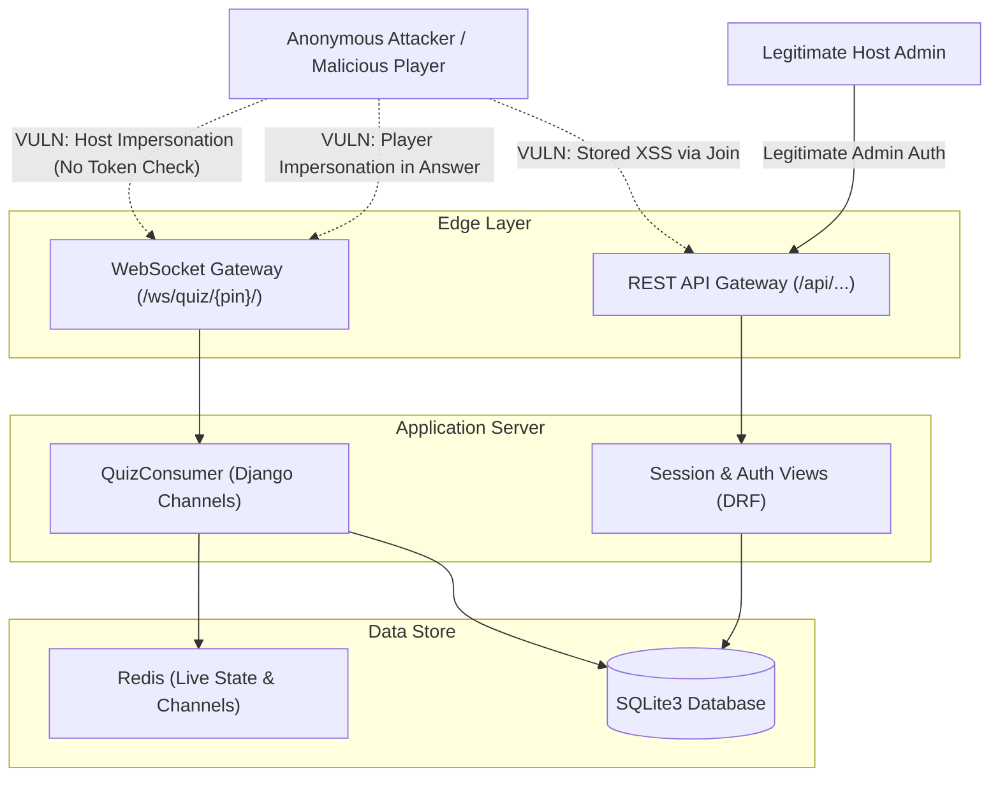

# QUIZ MASTER — DEFENSIVE SECURITY AUDIT REPORT

**Audit Date:** November 17, 2026  
**Auditor:** Senior Application Security & Defensive Testing Architect  
**Classification:** Confidential / Technical Vulnerability Assessment  
**Application:** Quiz Master Multiplayer Platform  
**Target Surface:** REST API (`http://127.0.0.1:8001`), WebSocket Gateway (`ws://127.0.0.1:8001`), Redis Layer (`127.0.0.1:6379`)  

---

## 1. Executive Security Summary

A defensive application security audit was performed against the Quiz Master architecture to identify authorization flaws, broken session management, injection vectors, and real-time multiplayer tampering vulnerabilities.

### Security Posture Matrix
- **Critical Vulnerabilities:** 1 (`BUG-01` — Host Role Hijacking)
- **High Vulnerabilities:** 2 (`BUG-03` — CSWSH, `BUG-04` — Player Impersonation)
- **Medium Vulnerabilities:** 1 (`BUG-07` — Stored XSS in Username)
- **Verified Secure Controls:**
  - **Answer Key Masking (`SEC-01`):** Correct answers are securely stripped from public REST endpoints (`/api/sessions/{code}/quiz/`) and participant WebSocket broadcasts.
  - **Server-Side Scoring (`SEC-09`):** Scores are computed exclusively on the server against verified database answer keys; client-injected score parameters are ignored.
  - **Endpoint Authorization (`SEC-02`, `SEC-03`):** Unauthenticated requests to start or terminate quizzes return `HTTP 401 Unauthorized`.

---

## 2. Threat Modeling & Attack Surface



---

## 3. Detailed Vulnerability Findings

### VULN-01: Unauthenticated WebSocket Host Role Hijacking (`BUG-01`)
- **Vulnerability ID:** `SEC-04` / `BUG-01`
- **Severity:** **CRITICAL** (CVSS v3.1: **9.8** / `AV:N/AC:L/PR:N/UI:N/S:U/C:H/I:H/A:H`)
- **CWE:** CWE-306: Missing Authentication for Critical Function
- **Affected File:** [`backend/quiz/consumers.py:289-305`](file:///C:/A2757/QuizProject/backend/quiz/consumers.py#L289-L305)
- **Vulnerability Description:**
  In `QuizConsumer._handle_join`, the application checks:
  ```python
  role = data.get("role", "participant")
  is_host = role == "host"
  ```
  If `role: "host"` is supplied, the connection is immediately flagged as `is_host = True` and registered as the session's active host channel without validating any credentials or Django REST Token.
- **Impact:**
  Any anonymous participant or external attacker who knows or discovers the 6-digit Game PIN can connect to the WebSocket and take over host privileges:
  - Prematurely start the quiz.
  - Advance questions arbitrarily.
  - Terminate the live session.
  - Lock out the legitimate host.
- **Empirical Proof of Concept:**
  ```json
  // Sent from unauthenticated script:
  {
    "action": "join",
    "username": "FakeHostHacker",
    "role": "host"
  }
  // Server Response:
  {
    "type": "joined",
    "username": "FakeHostHacker",
    "role": "host"
  }
  ```
- **Remediation:**
  Require an authentication token when `role == "host"`. Validate that the token exists in `rest_framework.authtoken.models.Token` and that `token.user == session.host`.

---

### VULN-02: Player Impersonation in WebSocket Answer Submissions (`BUG-04`)
- **Vulnerability ID:** `SEC-05` / `BUG-04`
- **Severity:** **HIGH** (CVSS v3.1: **7.5** / `AV:N/AC:L/PR:N/UI:N/S:U/C:N/I:H/A:N`)
- **CWE:** CWE-287: Improper Authentication
- **Affected File:** [`backend/quiz/consumers.py:483-525`](file:///C:/A2757/QuizProject/backend/quiz/consumers.py#L483-L525)
- **Vulnerability Description:**
  When processing an incoming `action: "answer"` message, the consumer extracts the username from the JSON payload:
  ```python
  username = data.get("username", "")
  ```
  It completely ignores the socket's established session identity (`self.username`).
- **Impact:**
  A malicious participant can send answer payloads on behalf of other players, locking out the victim with an incorrect choice, depleting their response time, or sabotaging competitors on the leaderboard.
- **Empirical Proof of Concept:**
  Connected as `AttackerSocket`, submitted `{ "action": "answer", "username": "PlayerVictim", "choice_id": 584 }`. Server logged and persisted the answer for `PlayerVictim`.
- **Remediation:**
  Strictly bind the answer submission to `self.username` (or `self.participant_id`). If `data.get("username")` is present and does not match `self.username`, reject the packet immediately.

---

### VULN-03: Cross-Site WebSocket Hijacking (CSWSH) via Wildcard Origin (`BUG-03`)
- **Vulnerability ID:** `SEC-07` / `BUG-03`
- **Severity:** **HIGH** (CVSS v3.1: **7.4** / `AV:N/AC:L/PR:N/UI:R/S:C/C:H/I:L/A:N`)
- **CWE:** CWE-346: Origin Validation Error
- **Affected File:** [`backend/backend/settings.py:53-56`](file:///C:/A2757/QuizProject/backend/backend/settings.py#L53-L56)
- **Vulnerability Description:**
  The ASGI routing wraps `QuizConsumer` in `AllowedHostsOriginValidator`. However, in `settings.py`:
  ```python
  ALLOWED_HOSTS = env_list('DJANGO_ALLOWED_HOSTS', 'localhost,127.0.0.1,0.0.0.0,*')
  ```
  The inclusion of `'*'` causes `AllowedHostsOriginValidator` to accept WebSocket handshakes from **any external origin** (e.g. `http://malicious-site.com`).
- **Impact:**
  A third-party website visited by a participant or host can initiate a background WebSocket connection to `ws://127.0.0.1:8001/ws/quiz/{pin}/` and eavesdrop on live questions or manipulate live gameplay.
- **Remediation:**
  Remove `'*'` from `ALLOWED_HOSTS`. Explicitly define trusted frontend domains (e.g. `['localhost', '127.0.0.1', 'vdart.quizmaster.com']`).

---

### VULN-04: Stored Cross-Site Scripting (XSS) in Participant Username (`BUG-07`)
- **Vulnerability ID:** `SEC-08` / `BUG-07`
- **Severity:** **MEDIUM** (CVSS v3.1: **6.1** / `AV:N/AC:L/PR:N/UI:R/S:C/C:L/I:L/A:N`)
- **CWE:** CWE-79: Improper Neutralization of Input During Web Page Generation
- **Affected File:** [`backend/quiz/views.py:328-354`](file:///C:/A2757/QuizProject/backend/quiz/views.py#L328-L354) & [`backend/quiz/models.py:75-80`](file:///C:/A2757/QuizProject/backend/quiz/models.py#L75-L80)
- **Vulnerability Description:**
  The join endpoint accepts arbitrary strings for `username` without HTML sanitization or character restrictions. When tested with `<script>alert('xss')</script>`, the string was persisted verbatim in the `quiz_participant` table and returned unescaped in REST participants list and WebSocket broadcast events.
- **Impact:**
  If a frontend component or administrative dashboard renders the participant's name using `dangerouslySetInnerHTML` or an unescaped DOM insertion, arbitrary JavaScript executes in the host or audience context.
- **Remediation:**
  1. Enforce a regex pattern at the view and serializer level: `^[a-zA-Z0-9_\-\s]{2,25}$`.
  2. Escape or strip HTML entities using `django.utils.html.escape` before database persistence.

---

## 4. Defensive Security Roadmap & Fix Priority

| Vulnerability | Remediation Priority | Recommended Implementation |
|---|---|---|
| **Host Role Hijacking** | **P0 (Immediate)** | Validate host token against `QuizSession.host` in consumer `_handle_join` |
| **Player Impersonation** | **P1 (Immediate)** | Bind answer processing strictly to socket-authenticated `self.username` |
| **CSWSH Wildcard Origin** | **P1 (Immediate)** | Remove `'*'` from `ALLOWED_HOSTS` and restrict `AllowedHostsOriginValidator` |
| **Live Vote Count Inflation** | **P1 (Immediate)** | Check `session:{pin}:voted:{qid}` set before issuing Redis `HINCRBY` |
| **Stored Username XSS** | **P2 (Scheduled)** | Add regex validation `^[a-zA-Z0-9_\s]{2,25}$` and strip HTML in join API |
